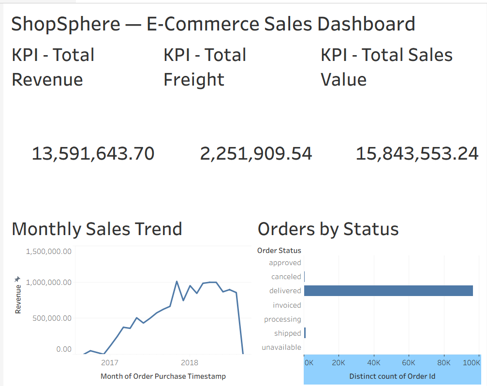

# ShopSphere
### End-to-End E-Commerce Data Engineering & Analytics Platform

ShopSphere is an end-to-end data engineering portfolio project built using the **Olist Brazilian E-Commerce Dataset**. It transforms raw e-commerce data into validated, analytics-ready datasets, models business entities and transactions, loads the resulting data into a PostgreSQL data warehouse, and delivers business insights through SQL and a Tableau dashboard.

The project demonstrates a complete local data engineering workflow, from source-data profiling and quality checks to dimensional modeling, warehouse validation, and business analytics.

## Project Overview

**Objective:** Build a reliable data pipeline that converts raw e-commerce data into structured datasets for business analysis.

**Pipeline:** Raw CSV → Data Profiling → Bronze → Silver → Gold → PostgreSQL Data Warehouse → SQL Analytics → Tableau Dashboard

**Project status:** Core Level 1 pipeline and analytics completed.

## Dashboard Preview



## Technology Stack

| Area | Technologies |
|---|---|
| Programming | Python |
| Data processing | Pandas |
| Columnar storage | Apache Parquet, PyArrow |
| Data warehouse | PostgreSQL 16 |
| Database deployment | Docker |
| Database connectivity | SQLAlchemy, psycopg2 |
| Business analytics | SQL |
| Data visualization | Tableau Desktop Free Edition |
| Development environment | Visual Studio Code, Git |

## Dataset

**Source:** [Olist Brazilian E-Commerce Dataset — Kaggle](https://www.kaggle.com/datasets/olistbr/brazilian-ecommerce)

The dataset contains nine CSV files covering customers, orders, order items, payments, reviews, products, sellers, geolocation, and product-category translations.

The source data provides the foundation for analyzing sales performance, product and category performance, seller performance, customer spending, and order trends.

## Data Engineering Architecture

```text
                Olist CSV Files
                      |
                      v
               Data Profiling
                      |
                      v
                BRONZE LAYER
             Source data in Parquet
                      |
                      v
                SILVER LAYER
          Cleaning and quality checks
                      |
                      v
                 GOLD LAYER
                      |
             +--------+--------+
             |                 |
             v                 v
        Dimensions          Fact Tables
        Customers           Sales
        Products            Payments
        Categories          Reviews
        Sellers
        Dates
             |                 |
             +--------+--------+
                      |
                      v
              Analytical Datasets
             Customer 360 and Sales
                      |
                      v
             PostgreSQL Warehouse
                      |
                      v
                SQL Analytics
                      |
                      v
              Tableau Dashboard
```

## Implementation Details

### 1. Data Profiling

Before transforming the source data, the project profiles the datasets to understand their structure and identify data-quality issues.

**Implemented activities**
- Dataset summaries and row counts
- Missing-value analysis
- Uniqueness and duplicate analysis
- Investigation of key columns and relationships

**Script:** `scripts/profile_olist.py`

**Outputs:** `reports/data_profiling/`

This step establishes a baseline for understanding the source data before cleaning or modeling it.

### 2. Bronze Layer — Raw Data Storage

The Bronze layer converts the original CSV datasets into Parquet files, providing a structured intermediate storage layer for subsequent processing.

**Script:** `scripts/build_bronze.py`

**Output:** `data/bronze/`

The original CSV files remain the source of truth, while the Bronze layer provides a consistent input for downstream transformations.

### 3. Silver Layer — Data Cleaning and Validation

The Silver layer prepares the data for analytical modeling by applying cleaning rules and checking data quality.

**Implemented activities**
- Duplicate detection and removal where appropriate
- Data validation and consistency checks
- Order-date sequence validation
- Investigation and documentation of source-data anomalies

**Scripts**
- `scripts/build_silver.py`
- `scripts/validate_silver.py`
- `scripts/investigate_silver_anomalies.py`

**Output:** `data/silver/`

The geolocation dataset was reduced from **1,000,163 to 738,332 rows** after removing 261,831 exact duplicate rows.

The validation process also identified order-date anomalies: 1,359 orders had approval timestamps after carrier timestamps, and 23 had carrier timestamps after customer-delivery timestamps. These anomalies were preserved and flagged rather than silently corrected.

This approach makes data-quality issues visible while maintaining traceability to the source.

### 4. Gold Layer — Dimensional Modeling

The Gold layer organizes cleaned data into dimension tables, fact tables, and analytical datasets for reporting.

**Dimension tables**

| Dimension | Purpose |
|---|---|
| `dim_customer` | Customer attributes |
| `dim_product` | Product attributes and category mapping |
| `dim_category` | Product-category information |
| `dim_seller` | Seller attributes |
| `dim_date` | Calendar attributes for time-based analysis |

**Fact tables**

| Fact table | Grain |
|---|---|
| `fact_sales` | One row per order item |
| `fact_payments` | One row per payment sequence/transaction |
| `fact_reviews` | One row per review record |

The fact tables use separate grains because sales items, payment transactions, and reviews have different relationships to orders. Joining multiple one-to-many fact tables directly can multiply rows and inflate metrics. Keeping the facts separate helps preserve accurate aggregations.

**Dimension-building scripts**
- `scripts/build_gold_dimensions.py`
- `scripts/build_gold_product_dimension.py`
- `scripts/build_gold_seller_dimension.py`
- `scripts/build_gold_date_dimension.py`

**Fact-building scripts**
- `scripts/build_fact_sales.py`
- `scripts/build_fact_payments.py`
- `scripts/build_fact_reviews.py`

**Output:** `data/gold/`

### 5. Customer 360 and Sales Analytics

The project creates two additional Gold-layer analytical datasets.

**Customer 360**

Script: `scripts/build_customer_360.py`

- 99,441 customer records
- One row per customer
- Combines customer-level information with separately aggregated purchasing, payment, and review metrics

The fact metrics are aggregated separately before being combined, preventing transaction fan-out from inflating customer metrics.

**Overall Sales Analytics**

Script: `scripts/build_overall_sales.py`

Produces a consolidated dataset containing overall order, item, revenue, freight, sales-value, and average-value metrics.

**Validation scripts**
- `scripts/validate_customer_360.py`
- `scripts/validate_fact_sales.py`
- `scripts/validate_fact_payments.py`
- `scripts/validate_fact_reviews.py`

### 6. PostgreSQL Data Warehouse

The Gold-layer tables are loaded into a local PostgreSQL 16 database running in Docker.

**Database:** `shopsphere_dw`

**Implemented activities**
- Warehouse table creation
- Loading Gold datasets using Python and SQLAlchemy
- Database connectivity through psycopg2
- Row-count and duplicate-key validation
- Fact-table foreign-key and relationship checks

**Scripts**
- `scripts/create_warehouse.sql`
- `scripts/load_gold_to_postgres.py`
- `scripts/validate_warehouse.sql`

The validated warehouse contains nine tables: five dimensions, three fact tables, and the Customer 360 analytical table.

### 7. SQL Business Analytics

Seven SQL files provide business analysis and validation.

| File | Analysis |
|---|---|
| `01_overall_kpis.sql` | Overall business KPIs |
| `02_monthly_sales.sql` | Monthly sales trends |
| `03_product_performance.sql` | Product-level performance |
| `04_category_performance.sql` | Category-level performance |
| `05_seller_performance.sql` | Seller-level performance |
| `06_customer_performance.sql` | Customer spending analysis |
| `07_validate_analytics.sql` | Analytical result validation |

Location: `scripts/analytics/`

These queries demonstrate aggregation, joins, grouping, ranking, and analytical reporting against the PostgreSQL warehouse.

### 8. Tableau Dashboard

The Tableau workbook connects to PostgreSQL and presents selected business metrics in a visual dashboard.

**Workbook:** `ShopSphere_Dashboard.twb`

The completed dashboard includes:
- Total revenue KPI
- Total freight KPI
- Total sales value KPI
- Monthly sales trend
- Orders by status

The dashboard provides a visual summary of the SQL analytics and makes key business metrics easier to interpret.

## Key Business Results

The following metrics were produced by the project's overall sales analytics.

| Metric | Result |
|---|---:|
| Orders represented in the sales fact | 98,666 |
| Order items | 112,650 |
| Total product revenue | 13,591,643.70 |
| Total freight | 2,251,909.54 |
| Total sales value, including freight | 15,843,553.24 |
| Average order value | 160.58 |
| Average item value | 140.64 |
| Customers in Customer 360 | 99,441 |
| Products in product dimension | 32,951 |
| Sellers in seller dimension | 3,095 |
| Categories in category dimension | 71 |

**Metric definitions**
- **Total product revenue:** Sum of item prices.
- **Total freight:** Sum of freight charges.
- **Total sales value:** Product revenue plus freight.
- **Average order value:** Total product revenue divided by the 98,666 distinct orders represented in the sales fact.

Monetary values are expressed in the dataset's currency, Brazilian real (BRL). The order count above is based on orders represented in the sales fact, not every record in the source orders table.

### Selected Findings

- Health and beauty was the highest-revenue category in the category analysis, with sales value of approximately 1.44 million BRL.
- The leading seller in the seller analysis generated approximately 249,640.70 BRL in sales value.
- The highest-spending customer in Customer 360 had product spending of 13,664.08 BRL.
- The monthly sales query returned 24 monthly records across the available reporting period.

These findings demonstrate how the processed data can support product, category, seller, customer, and time-based business analysis.

## Data Quality and Validation Results

Validation was performed at the Silver, Gold, warehouse, and analytics stages.

- Silver validation: 35 of 37 checks passed; the remaining checks identified source-data date-sequence anomalies.
- Sales fact validation: 11 of 11 checks passed.
- Payment fact validation: 10 of 11 checks passed; the outstanding issue concerned source payment-installment values below one.
- Review fact validation: 10 of 10 checks passed.
- Customer 360 validation: 12 of 12 checks passed.
- Warehouse validation: expected row counts matched, duplicate-key counts were zero across the nine validated tables, and the checked sales relationships and required Customer 360 keys passed.
- SQL analytics validation: passed.

The project distinguishes between validation failures caused by source-data anomalies and failures caused by transformation logic. Known anomalies are documented rather than misrepresented as fully corrected data.

## Repository Structure

```text
ShopSphere_Project/
├── data/
│   ├── raw/
│   ├── bronze/
│   ├── silver/
│   └── gold/
├── reports/
│   └── data_profiling/
├── scripts/
│   ├── analytics/
│   │   ├── 01_overall_kpis.sql
│   │   ├── 02_monthly_sales.sql
│   │   ├── 03_product_performance.sql
│   │   ├── 04_category_performance.sql
│   │   ├── 05_seller_performance.sql
│   │   ├── 06_customer_performance.sql
│   │   └── 07_validate_analytics.sql
│   ├── profile_olist.py
│   ├── build_bronze.py
│   ├── build_silver.py
│   ├── validate_silver.py
│   ├── build_gold_dimensions.py
│   ├── build_gold_product_dimension.py
│   ├── build_gold_seller_dimension.py
│   ├── build_gold_date_dimension.py
│   ├── build_fact_sales.py
│   ├── build_fact_payments.py
│   ├── build_fact_reviews.py
│   ├── build_customer_360.py
│   ├── build_overall_sales.py
│   ├── load_gold_to_postgres.py
│   ├── create_warehouse.sql
│   └── validate_warehouse.sql
├── ShopSphere_Dashboard.twb
└── README.md
```

Additional validation and investigation scripts are included in `scripts/`. Generated data and reports are produced by the pipeline and are not all listed individually above.

## Running the Project Locally

### Prerequisites

- Python
- Docker Desktop
- PostgreSQL Docker image
- Python packages: Pandas, PyArrow, SQLAlchemy, and psycopg2-binary
- Tableau Desktop, to open the dashboard

### 1. Prepare the environment

Run the following commands from the project root in PowerShell:

```powershell
python -m venv .venv
.\.venv\Scripts\Activate.ps1
python -m pip install pandas pyarrow sqlalchemy psycopg2-binary
```

### 2. Add the source data

Place the original Olist CSV files inside `data/raw/`.

### 3. Run profiling and transformations

Run the profiling and Bronze/Silver stages:

```powershell
python scripts/profile_olist.py
python scripts/build_bronze.py
python scripts/build_silver.py
python scripts/validate_silver.py
```

Build the Gold dimensions and facts:

```powershell
python scripts/build_gold_dimensions.py
python scripts/build_gold_product_dimension.py
python scripts/build_gold_seller_dimension.py
python scripts/build_gold_date_dimension.py
python scripts/build_fact_sales.py
python scripts/build_fact_payments.py
python scripts/build_fact_reviews.py
```

Build and validate the analytical datasets:

```powershell
python scripts/build_customer_360.py
python scripts/build_overall_sales.py
python scripts/validate_fact_sales.py
python scripts/validate_fact_payments.py
python scripts/validate_fact_reviews.py
python scripts/validate_customer_360.py
```

### 4. Start PostgreSQL

For an existing ShopSphere container:

```powershell
docker start shopsphere-postgres
```

For a new environment, create and configure the PostgreSQL container using your own local credentials and the database settings required by the loader.

### 5. Load and validate the warehouse

Configure the connection settings used by `scripts/load_gold_to_postgres.py`, then run:

```powershell
python scripts/load_gold_to_postgres.py
```

Execute the warehouse validation script:

```powershell
Get-Content .\scripts\validate_warehouse.sql |
    docker exec -i shopsphere-postgres psql -U shopsphere -d shopsphere_dw
```

### 6. Run SQL analytics

For example, run the overall KPI query:

```powershell
Get-Content .\scripts\analytics\01_overall_kpis.sql |
    docker exec -i shopsphere-postgres psql -U shopsphere -d shopsphere_dw
```

The other SQL files can be executed similarly.

### 7. Open the dashboard

Open `ShopSphere_Dashboard.twb` in Tableau Desktop and connect to the PostgreSQL database using your local connection settings.

**Note:** The commands above describe the pipeline stages and the current local setup. Database credentials, Docker configuration, and any environment-specific paths must be configured for the machine on which the project is run.

## Engineering Concepts Demonstrated

- Multi-stage data pipeline design
- Data profiling and data-quality validation
- Parquet-based intermediate storage
- Bronze–Silver–Gold architecture
- Dimensional modeling and fact-table grain
- Relational joins and referential integrity checks
- Aggregation without fact-table fan-out
- PostgreSQL warehouse loading
- SQL-based business analytics
- Tableau dashboard development
- Handling and documenting imperfect source data

## Future Scope

The current implementation focuses on a local, Python-based data engineering pipeline. Distributed processing, automated orchestration, and cloud deployment may be considered as future enhancements, but they are not part of the completed implementation described here.

## Project Summary

ShopSphere demonstrates the transformation of raw e-commerce data into validated analytical datasets, the construction and validation of a PostgreSQL warehouse, and the delivery of business insights through SQL and Tableau. It combines practical data processing, data modeling, database engineering, data-quality validation, and analytics in one end-to-end portfolio project.